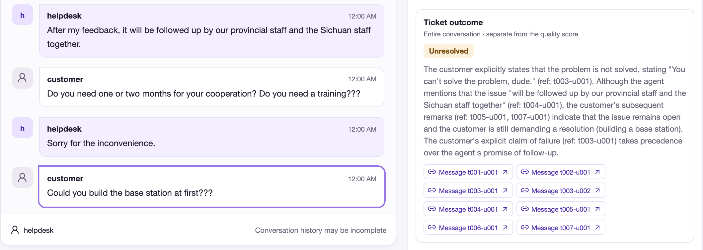
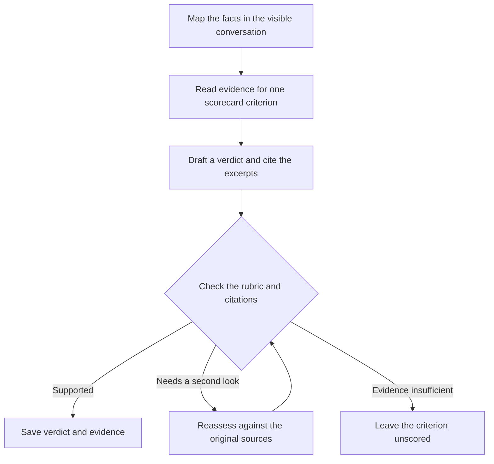

# CHECK

CHECK is a self-hosted quality assurance application for closed support conversations. It imports tickets, evaluates replies against a versioned scorecard, and shows reviewers the evidence behind each verdict. Use a local model or connect a cloud provider.

[Quick start](#quick-start) · [Agent review loop](#agent-review-loop) · [DCH-2 results](#dch-2-results) · [Case study](#case-study-of-a-promised-follow-up)



In DCH-2 ticket **4238092258439474**, Gemma 4 26B marked the issue **Unresolved**. Selecting `Message t007-u001` highlights the customer's final request on the left. The benchmark uses placeholder timestamps to preserve turn order. [Case study](#case-study-of-a-promised-follow-up) · [DCH-2 dialogue terms](https://dialeval-2.github.io/DCH-2/terms)

## Agent review loop

In local agent mode, CHECK builds a map of the customer's requests and the agent's commitments, with links to the original messages. It reuses that map across criteria. For a short ticket it reads the full exchange. For a longer one it can look up a message, read its neighbors, or search for exact text.



For **response completeness**, a draft `pass` triggers a second search for overlooked requests. If it finds one, the agent checks which later reply addressed it. For **ownership**, it checks who promised the next action and whether it came due. Review passes are bounded. CHECK verifies cited text against the saved sources and exposes the evidence trail in `result.agent_trace`. Timing and other rule-based checks run separately. [Agent implementation](backend/qa/agent.py) · [Citation verification](backend/qa/evidence.py)

## DCH-2 results

All four configurations assessed the same **20 English support dialogues**. DCH-2 annotators rated how far each customer's problem was solved on a scale from −2 to +2 (the **A-score**). Eleven dialogues had a negative majority, five had a positive majority, and four had neither. The first two rows show how often CHECK assigned the corresponding final status in each group. A proposed fix can earn positive human votes while CHECK still waits for confirmation. [DCH-2 dataset and annotation guide](https://dialeval-2.github.io/DCH-2/)

| Measure | Gemma 4 12B IT | Gemma 4 26B A4B | GPT-6.1 Terra | GPT-6 Astra |
| --- | ---: | ---: | ---: | ---: |
| Negative-majority tickets called `unresolved` | 3 / 11 | 7 / 11 | 6 / 11 | 7 / 11 |
| Positive-majority tickets called `resolved` | 1 / 5 | 1 / 5 | 2 / 5 | 2 / 5 |
| Tickets with a verified source quote for the outcome | 20 / 20 | 20 / 20 | 17 / 20 | 20 / 20 |
| Mean weighted scorecard coverage | 67.8% | 72.4% | 66.9% | 68.9% |
| Median evaluation time per ticket | 6 min 19 s | 2 min 43 s | 1 min 02 s | 1 min 36 s |
| Mean model API cost per ticket (USD) | $0 locally | $0 locally | ~$0.039 | ~$0.496 |

On these 20 tickets, Gemma 26B gave the widest scorecard coverage and flagged as many negative-majority cases as Astra. Terra flagged one fewer at about four cents per ticket. The local 12B run also assessed each individual customer request, adding work to its timing. [Per-ticket measurements (CSV)](docs/dch2-results.csv)

<details>
<summary>Run settings, metric definitions and cost calculation</summary>

- **Sample.** We sorted the English DCH-2 development set by mean A-score, divided the eligible dialogues into 20 bands, and took the longest exchange by message count in each band. The sample spans easy and ambiguous outcomes. Human labels cover task accomplishment, satisfaction and effectiveness. CHECK's individual QA criteria have no human labels in this comparison.
- **Runs.** Gemma ran locally with MLX, the English v5 scorecard and agent v13 in Quality mode (12B at 4-bit, 26B at 3-bit). Terra and Astra used the Russian v4 scorecard and ten direct Codex CLI calls per ticket at medium reasoning effort. All runs had an empty policy library. The table compares these complete configurations.
- **Metrics.** A majority means more than half of all votes are negative or positive. A verified quote is an excerpt found in the cited message. Coverage measures how much applicable criterion weight received a score. We use the 11 criteria shared with v5, round each ticket's coverage to a whole percent as CHECK does, then average all 20. The four dialogues without a majority count in coverage, timing and cost.
- **Time and cost.** Gemma time is evaluator runtime excluding queue wait. For Terra and Astra we sum the ten recorded call durations per ticket, including CLI startup, so resumed work counts in full. Local inference incurred zero model API fees. Electricity and hardware costs were unmeasured. For the cloud runs we priced recorded uncached input, cached input and output tokens at standard API rates on November 18, 2026, then divided by 20. Rates in USD per million tokens were 1 / 0.05 / 5 for Terra and 10 / 1 / 50 for Astra. These are API-equivalent estimates for the CLI runs. [Terra pricing](https://developers.openai.com/api/docs/models/gpt-6.1-terra) · [Astra pricing](https://developers.openai.com/api/docs/models/gpt-6-astra)

Vote counts in the per-ticket file are derived from the DialEval-2 organizers' annotations under CC BY 4.0. [DCH-2 terms and annotation license](https://dialeval-2.github.io/DCH-2/terms)

</details>

### Case study of a promised follow-up

In dialogue **4238092258439474**, a customer reported that a mobile network issue persisted. Support promised that two regional teams would follow up (turn 4). The customer questioned how long that would take (turn 5) and ended by asking for the base station to be built (turn 7).

Gemma 12B cited the promised follow-up and returned `solution_proposed`. Gemma 26B, Terra and Astra returned `unresolved`, citing the customer's continuing request. **Nineteen of 20 annotators gave task accomplishment a negative score** and one voted neutral. All four models gave support partial credit for ownership. The team had identified who would act, but the customer's last message still asked for the work to be done.

## Quick start

Install Docker with Compose, then run:

```sh
docker compose up -d --build
```

Open [CHECK](http://localhost:8080) and select a synthetic demo ticket. Ticket **1048** shows a first-response target breach. Open the supporting message, record a review decision, or export the assessment as JSON. The [OpenAPI documentation](http://localhost:8080/api/docs) describes the API.

To use your own data, copy `.env.example` to `.env`, set `QA_DEMO=false`, and configure `QA_TOKEN` and `QA_ORG`. Sign in with that token. Set strong, URL-safe values for the database and broker passwords before creating their volumes. Compose binds the web port to loopback. PostgreSQL and RabbitMQ persist data in named volumes.

When updating an existing installation, reuse its Compose project name through `COMPOSE_PROJECT_NAME` or `docker compose -p <existing-project>` to keep using the same volumes. Changing connection passwords in `.env` does not update credentials in existing volumes.

## Evaluation models

Open **Model settings** from the gear icon. The header displays the active mode and model. **Test connection** sends a short synthetic JSON request. **Save settings** selects the profile for new evaluations. Existing jobs retain the model and limits captured at submission.

- **Local** offers two Gemma MLX presets and **Custom model** for another model ID on your Ollama-compatible server. Set an output limit and, when supported, context and reasoning limits. Enable **Agent mode** and **Quality mode** for the agent's evidence checks and extra verification passes.
- **Cloud** supports OpenAI, OpenRouter, Anthropic, and Google Gemini. Supply the provider's model ID, API key, and output limit. A blank key field keeps the saved key for that provider. CHECK stores keys in PostgreSQL and omits them from the settings response and exports. Cloud evaluations send relevant message excerpts and policy fragments to the selected provider.

### Local Gemma on Apple Silicon

The presets use [Gemma 4 12B IT, 4-bit](https://huggingface.co/mlx-community/gemma-4-12B-it-4bit) and [Gemma 4 26B A4B IT, 3-bit](https://huggingface.co/unsloth/gemma-4-26b-a4b-it-UD-MLX-3bit). Run the adapter natively on your Mac. Install Python 3.13 and use the following commands from the repository root:

```sh
CHECK_HOME="$HOME/.local/share/check"
python3.13 -m venv "$CHECK_HOME/mlx-venv"
"$CHECK_HOME/mlx-venv/bin/python" -m pip install -r backend/mlx/requirements.txt
"$CHECK_HOME/mlx-venv/bin/hf" download mlx-community/gemma-4-12B-it-4bit \
  --local-dir "$CHECK_HOME/gemma-4-12b-it-4bit"
"$CHECK_HOME/mlx-venv/bin/hf" download unsloth/gemma-4-26b-a4b-it-UD-MLX-3bit \
  --local-dir "$CHECK_HOME/gemma-4-26b-a4b-it-3bit"
"$CHECK_HOME/mlx-venv/bin/python" backend/mlx/serve.py "$CHECK_HOME/gemma-4-12b-it-4bit" \
  --model-id gemma4:12b-it-4bit-mlx \
  --extra-model "gemma4:26b-a4b-3bit-mlx=$CHECK_HOME/gemma-4-26b-a4b-it-3bit" \
  --context-length 8192 --max-output-tokens 1024 --thinking-budget 768
```

Set `OLLAMA_URL=http://host.docker.internal:11436` in `.env`. Start CHECK with the MLX Compose overlay:

```sh
docker compose -f compose.yaml -f compose.mlx.yaml up -d --build
```

Under **Model settings → Local → Local model**, choose either Gemma preset. Start with 8,192 context tokens, 1,024 output tokens, and 768 reasoning tokens. Choose **Test connection**, then **Save settings**. The adapter loads a different model on its first request and keeps one set of weights in memory at a time. The first request after a switch can take longer. Service limits apply to both presets and the context window includes input, output, and reasoning.

The MLX overlay runs one evaluation worker and enables conversation-prefix caching. The adapter reuses a matching prefix within an attempt and clears the cache when the attempt ends or the model changes. See `result.usage.prompt_eval_cached_count` in the assessment export. The overlay defaults to 150 seconds per model call and 1,800 seconds per evaluation. Set `OLLAMA_TIMEOUT_SECONDS`, `QA_TASK_TIMEOUT_SECONDS`, or `MLX_PROMPT_CACHE` in `.env` to override them.

### Other local servers

For Ollama, set `OLLAMA_URL` to a URL reachable from Docker, select **Custom model**, and enter the exact installed model ID. Select a model that supports structured JSON output. Set `QA_MODEL` in `.env` to seed the model ID before a profile has been saved. See [Ollama structured outputs](https://docs.ollama.com/capabilities/structured-outputs).

## Tickets and API

- Import a JSON ticket or array of tickets, or CSV with one row per message. See the [JSON sample](frontend/public/example.json) and the [refund example](frontend/public/example-refund.json). CSV groups messages by `source` and `external_id`. Required columns are `external_id,subject,message_id,actor_id,author,role,at,text`. Optional columns include `source,channel,language,product,category,status,messages_complete,public,created_at,closed_at`. Use JSON for events.
- Supply timezone-aware timestamps. Set `messages_complete` and `events_complete` only where you can establish that the history is complete. A request can contain up to 5 MB and 100 tickets. Each ticket can contain up to 300 messages and 300 events.
- Closed-ticket imports queue an evaluation. Open tickets can be saved through the import flow and evaluated after a closed revision is imported.
- A reviewer can confirm the assessment, correct a verdict or outcome, or flag insufficient evidence or a rubric issue. CHECK records decisions separately from the original assessment. Export includes the ticket, run configuration, evidence, and review history.
- **New evaluation** can assess the whole conversation, an individual participant, or a single public support reply. A single-reply assessment uses only the history available through that reply.

### Submit and retrieve evaluations

`POST /api/runs` accepts one closed ticket or an array of 1–100 closed tickets in the same JSON format as import. Use an `Authorization: Bearer <token>` header when `QA_TOKEN` is configured.

```sh
curl --fail-with-body -sS http://localhost:8080/api/runs \
  -H 'Content-Type: application/json' \
  -H "Authorization: Bearer ${QA_TOKEN}" \
  --data-binary @frontend/public/example.json
```

The `202 Accepted` response includes `items` in submission order. Each item has `external_id`, `revision_id`, `run_id`, `status`, and `status_url`. A single-ticket submission also returns `Location`.

Poll `GET /api/runs/{run_id}` with the same authentication. A `complete` run includes `result`. A `failed` run includes `error`. If a model is unavailable, an otherwise completed run can contain computed checks and `insufficient_evidence` for model checks, so inspect coverage and the explanations. Reposting an identical ticket revision with the same evaluation configuration returns the same `run_id`. An invalid or open ticket causes the whole batch to be rejected. Use `POST /api/import` for CSV or open tickets.

## Scorecard and outcomes

Open **Scorecard → Edit scorecard** to add, reorder, edit, or delete groups and criteria. Use **Save version** to publish your changes for new evaluations. CHECK preserves the configuration snapshot in each run. The editor allows up to 20 groups and 40 criteria. A group with positive weight requires at least one positively weighted criterion. Computed checks retain their built-in descriptions and rubrics, while names, weights, and review settings are editable.

The active scorecard comes from `GET /api/settings`. Publish through `PUT /api/card` with `base_version`, `name`, `groups`, `criteria`, and optional `timing_targets`. A stale edit receives HTTP 409. The initial scorecard is in [standard.yaml](backend/cards/standard.yaml).

| Measure | Calculation |
| --- | --- |
| Quality score | Score each criterion as `pass = 1`, `partial = 0.5`, or `fail = 0`. Average scored criteria within each group by criterion weight, then average scored groups by group weight and multiply by 100. |
| Weighted coverage | Average the share of checked weight in each applicable group by group weight. |
| Count coverage | Divide scored criteria by applicable criteria. This measure includes control checks. |

`not_applicable` is excluded from both score and coverage. `insufficient_evidence` is excluded from the score and lowers coverage. Zero-weight checks can still flag critical findings. A metric with no denominator returns `null`. Historical scorecards without group weights use their saved flat criterion weights.

**Timing targets** are measured separately in calendar seconds. Channel overrides take precedence over defaults. The first-response timer requires a complete history and runs from the first public customer message to the first public support reply. Chat defaults to 900 seconds. Time to close uses `created_at` or the first public customer message in a complete history, and requires `closed_at` or a `ticket_closed` event. A late result shows the delay.

**Ticket outcome** is separate from the quality score. `result.outcome.status` can be `resolved`, `solution_proposed`, `escalated`, `unresolved`, or `unknown`. Resolution requires customer confirmation or a supporting outcome event. Closure, silence, and an agent's success claim are insufficient on their own. Escalation requires a confirmed handoff. When supported by reliable evidence, connectors can supply `issue_resolved`, `issue_unresolved`, or `case_escalated` events.

`result.request_outcome` tracks each material customer request. It assigns 100 for confirmed resolution, 75 for an achieved primary result, 50 for a verified partial result, 25 for a concrete fix with unknown effect, and 0 for a confirmed unresolved request. The outcome score is the mean across scored requests. Coverage is the share of identified requests with a score.

The optional `refund` object can carry `decision`, `due_at`, `operation_id`, `owner_id`, and `completion_claim_message_id`. Use a public support reply for a claim that the refund already happened. Match `operation_id` to a `refund_completed` event. A missed approved refund or an unsupported completion claim requires a complete event history. The default scorecard includes this as a zero-weight control.

### Agent review questions

The agent builds a fact map and links decisions to readable excerpts. It evaluates completeness per customer request, checks whether support addressed each request after it was raised, and revisits the request list before assigning `pass`. A handoff or request for information counts toward completeness when it advances that specific question. Ownership checks consider the next action, its owner, applicable conditions, timing, and evidence of fulfillment. Trace details are available under `result.agent_trace`.

CHECK stores internal review questions in [agent-checks-v13.yaml](backend/cards/agent-checks-v13.yaml). After editing the public rubric, use the [scorecard and agent guide](docs/agent-scorecard.md) to update the internal questions with Claude Code or Codex.

## Knowledge base

Open **Knowledge** and select a folder with `index.md`, `manifest.json`, and the linked Markdown instructions. Review the preview, then choose **Publish bundle**. See the [bundle format and conversion prompt](docs/knowledge.md).

CHECK searches matching index sections first. If it cannot find a matching rule there, it searches the rest of the library. Each match must satisfy the ticket's language, product, and category, the policy's effective and available dates, and the support participant's audience eligibility. **Rule preview** shows the relevant source. The evaluation snapshots the rules it used and verifies quotes against those snapshots. Policy accuracy requires applicable, available knowledge.

## Zendesk

1. Create a confidential OAuth client for an administrator with ticket access and the scopes `tickets:read users:read`. See the [Zendesk client credentials guide](https://developer.zendesk.com/documentation/authentication/oauth-migration/#client-credentials-grant).
2. Set `ZENDESK_SUBDOMAIN`, `ZENDESK_CLIENT_ID`, and `ZENDESK_CLIENT_SECRET` in `.env`. Set `ZENDESK_START_AT` to a timezone-aware ISO 8601 timestamp to override the initial 24-hour lookback. `ZENDESK_LANGUAGE` defaults to `en`.
3. Start and inspect the connector.

   ```sh
   docker compose --profile zendesk up -d --build
   docker compose logs -f zendesk
   ```

The connector polls every 120 seconds by default and ingests closed tickets with text comments and internal notes. A saved cursor takes precedence over the initial start time. The cursor commits with the revisions and jobs so a retry resumes consistently. Repeated exports of the same revision do not create duplicate evaluations. When the history exceeds import limits, the connector keeps the first 300 comments, truncates messages at 16,000 characters, and flags incomplete history. Attachments, audio, and operational events stay in Zendesk.

## Development

The web app uses React, TypeScript, and esbuild. FastAPI serves the API, PostgreSQL stores revisions and the evaluation outbox, and a dispatcher submits outbox jobs to Celery over RabbitMQ. The worker leases each evaluation before writing a result. See [CONTRIBUTING.md](CONTRIBUTING.md) for build and test commands.

CHECK is released under the [MIT License](LICENSE). Downloaded model weights have their own licenses.
